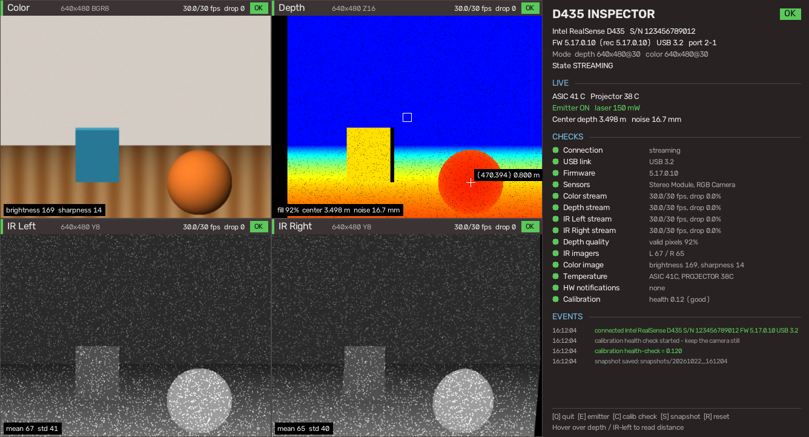

# D435 Inspector

A one-command health check for Intel RealSense D400 cameras (built for the D435).
It shows the color, depth and both infrared streams side by side, runs a set of health checks,
and keeps the camera firmware up to date. Works on **macOS (Apple Silicon)** and **Linux**.


<sub>The dashboard, rendered with demo data.</sub>

## Features

- Live view of all four streams: Color, Depth, IR Left, IR Right
- 14 health checks: USB link, firmware, frame rate, dropped or frozen frames, depth fill rate,
  left/right IR balance, exposure, temperatures, hardware errors and calibration health
- Finds which USB port the camera is on, and warns about USB 2, blocked ports and missing permissions
- Updates outdated firmware automatically (verified image, flash backed up first)
- Text / JSON report mode for scripts and headless machines
- Reconnects by itself when the camera is unplugged or reset
- Self-contained: everything is installed inside this folder, so deleting the folder uninstalls it

## Quick start

```bash
git clone <repo-url> d435-inspect-tool
cd d435-inspect-tool
./run-mac.sh       # macOS (Apple Silicon)
./run-linux.sh     # Linux (x86_64, or aarch64 such as Jetson)
```

The first run sets up a Python environment in `.venv/`, which takes a minute.
You may be asked for your password: the camera needs root on macOS, and on Linux unless
udev rules are installed (see [Linux](#linux)).

## Options

See all options, the dashboard keys and examples with:

```bash
./run-mac.sh --help      # or ./run-linux.sh --help
```

## Dashboard keys

| Key | Action |
|---|---|
| `Q` / `Esc` | Quit |
| `E` | Toggle the IR emitter |
| `C` | Calibration health check (5–15 s; keep the camera still, aim at a textured scene) |
| `S` | Save a snapshot to `snapshots/<time>/`: dashboard, every stream, raw 16-bit depth, report.json |
| `R` | Hardware-reset the camera |
| Mouse | Hover over Depth or IR Left to read the distance |

## Health checks

| Check | Rule |
|---|---|
| USB link | USB 3 is OK, USB 2 is a WARN |
| Firmware | older than the SDK's recommended version is a WARN |
| Sensors | stereo module and RGB camera must be present |
| Streams (×4) | FPS below 90% of target WARN; dropped frames ≥ 1% WARN, ≥ 5% FAIL; no frames for 3 s or a frozen image FAIL |
| Depth quality | valid pixels < 50% WARN (depends on the scene), about 0% FAIL |
| IR imagers | left/right brightness differs by > 30% WARN (dirty lens?), black image FAIL |
| Color image | black or over-exposed WARN |
| Temperature | ASIC / projector ≥ 55 °C WARN, ≥ 70 °C FAIL |
| HW notifications | errors reported by the camera; during the first 5 s of streaming they only WARN |
| Calibration | on-chip health check: < 0.25 good, < 0.75 WARN, ≥ 0.75 FAIL |

Thresholds are constants at the top of `d435_inspect.py`. The calibration check only *reads* the
health value: the original calibration is restored and nothing is written to the camera.

## Firmware update

Before inspecting, the launcher compares the camera firmware with the version recommended by the
bundled librealsense 2.56.5 (**5.17.0.10**). If the camera is older, it is updated automatically,
following Intel's `rs-fw-update` tool:

1. Download the image from Intel and verify its SHA-1 against librealsense's source
2. Back up the camera flash, including calibration, to `firmware/`
3. Check compatibility, flash, and wait for the camera to come back with the new version

It takes 1–2 minutes. **Don't unplug the camera meanwhile.** Without internet, a matching
checksum, a flash backup, or (on Linux) permission to reach the camera in update mode, the update
is skipped and the inspection runs as usual. If an update is interrupted, just run the launcher
again: it re-flashes a camera that is stuck in recovery mode.

## Where is my camera?

Every run starts with a USB check:

```
RealSense USB check:
  RealSense D435 on port 2-1, USB 3 (5 Gbps), USB serial 123456789012
    Devices: /dev/bus/usb/002/005 /dev/video0 /dev/video1 ...
```

If no camera is found:

- Use a USB 3 **data** cable (many USB-C cables only charge) and plug it in firmly
- Try flipping the USB-C plug at the camera end
- macOS: if the check reports a blocked port, unlock the Mac, replug and click **Allow**
  (System Settings → Privacy & Security → Allow accessories to connect)

On USB 2 everything works, but only at lower resolutions and frame rates.

## Platform notes

### macOS

- Apple Silicon only: the community `pyrealsense2-macosx` package has no Intel-Mac build.
- Runs with `sudo`, because librealsense talks to the camera directly over USB.
- macOS's own camera driver competes with librealsense for the camera, so the tool takes the
  camera over at start-up (`macos_usb_capture.py`, the same fix as
  [viam-camera-realsense#182](https://github.com/viam-modules/viam-camera-realsense/pull/182)).
  After quitting, **replug the camera** before using it in FaceTime, Zoom and other apps.

### Linux

- Needs Python 3.9–3.13 on x86_64, or 3.9–3.10 on aarch64. If none is installed, the launcher
  downloads [uv](https://github.com/astral-sh/uv) into `.uv/` and fetches a suitable Python there.
- OpenCV needs `libGL` and `glib`:
  `sudo apt install libgl1 libglib2.0-0` (Debian/Ubuntu) or `sudo dnf install mesa-libGL glib2` (Fedora).
- No display, e.g. over SSH? Use `./run-linux.sh --check`.
- To run without `sudo`, install Intel's udev rules. This writes to `/etc`, so the launcher never
  does it for you:

  ```bash
  sudo curl -fsSL -o /etc/udev/rules.d/99-realsense-libusb.rules \
    https://raw.githubusercontent.com/IntelRealSense/librealsense/v2.56.5/config/99-realsense-libusb.rules
  sudo udevadm control --reload-rules && sudo udevadm trigger
  ```

## Uninstall

Everything lives in this folder (`.venv/`, `.uv/`, `snapshots/`, `firmware/`): delete the folder.
On Linux, also delete `/etc/udev/rules.d/99-realsense-libusb.rules` if you installed it.

## Project layout

| File | Purpose |
|---|---|
| `run-mac.sh`, `run-linux.sh` | Launchers: set up `.venv`, check USB, start the inspector |
| `d435_inspect.py` | Dashboard, health checks and text report |
| `usb_ports.py` | Finds the camera's USB port and checks permissions |
| `firmware_update.py` | Automatic firmware update and recovery |
| `macos_usb_capture.py` | macOS: keeps the camera away from the system camera driver |

Tested with a D435 on an Apple Silicon Mac. Linux support is new; bug reports are welcome.

## License

[MIT](LICENSE). librealsense, OpenCV and NumPy are installed from PyPI under their own licenses,
and the camera firmware is downloaded from Intel at run time; none of them are part of this repo.
